# Live monitoring of chip flow in turning: iteration 2

ME361 · session of 4 Nov 2026 · 6 runs · top-view phone video + its sound track

> **In one line:** from one handheld phone video per cut we now get:
>
> - the chip ejection angle, frame by frame, and it survives every robustness check;
> - spindle speed and feed from the **sound** alone (rpm within 0.4%, feed within 2.6%);
> - an **entanglement alarm** that fires only on the run where the chips actually tangled;
> - a **live web app** (phone camera and microphone, laptop dashboard, calibration, replay mode) that reproduces the offline angles exactly on all six runs.
>
> We tried 11 parameter → angle models and 5 CNN set-ups. Feeding the CNN only the *moving* pixels cut its error from 8.8° to 6.8°. With 6 runs the simple linear model is still the most honest predictor, and the textbook flow-angle theory does not predict what the camera sees.

## 0. Everything we tried

| # | Experiment | What it tests | Outcome |
|---|---|---|---|
| 1 | Chip-angle measurement from video | Can a phone measure the chip direction? | ✓ ~3,100 frames, 6 runs |
| 2 | 4 measurement-setting variants + 2 alternative estimators | Is the measured angle an artefact of our settings? | ✓ Feed effect has the same sign in every reasonable variant |
| 3 | Rake-face flow theory (Colwell, Young–Mathew–Oxley) | Does textbook theory predict the angle? | ✗ It runs the wrong way (r = −0.52) |
| 4 | Physics hybrid: flow theory + chip up-curl | Can curl explain the gap? | ✗ Geometrically impossible for 2 of 6 runs |
| 5 | 11 parameter → angle models (linear, ridge, quadratic, GP, kNN, RF, physics) | Best predictor from f and ap | Linear f + ap: 6.6° vs 7.9° baseline |
| 6 | Frame-level model with time-in-cut | Is there a drift during the cut? | ✓ Error 9.1° → 7.2°; the angle rises during a cut |
| 7 | CNN v1 (ResNet-18, RGB) on Kaggle GPU | Angle straight from the image | ✗ Learns clip identity |
| 8 | CNN v2: motion input, masked background, frozen-feature probe | Does showing only the moving chips fix v1? | ✓ partly: motion input 6.8° vs 8.8° (RGB) |
| 9 | **Application: audio virtual sensor** | rpm, cut on/off, feed from the microphone | ✓ rpm −0.3%, feed ±2.6%, 6/6 |
| 10 | **Application: entanglement alarm** | Detect chip build-up without training | ✓ Fires only on R2, at the tangle |
| 11 | **Application: live-monitor dashboard video** | Everything combined, replayed in real time | ✓ `results/demo/*.mp4` |
| 12 | **Application: process map** | Pick settings for a target chip direction | ✓ fig. 9 |
| 13 | Inverse models (settings from video/audio) | Can the sensors tell us what the machine is doing? | Feed: audio ✓, video ✗. Depth: weak |
| 14 | **Application: live web app** with calibration and replay | Can the pipeline run live from a phone? | ✓ Replay equals the offline angles on 6/6 runs; server latency 26 ms; real phone not yet tested |
| 15 | **Literature check** (8 sources) | What can published work add? | Theory direction and chart axes used; the acoustic build-up cue did **not** reproduce with a phone microphone |

## 1. Data

| Run | Feed f (mm/rev) | Depth ap (mm) | Diameter (mm) | rpm (G96, Vc = 150 m/min) | Frames used |
|---|---|---|---|---|---|
| R1 | 0.08 | 0.9 | 32.0 → 30.2 | 1581 | 690 |
| R2 | 0.15 | 0.9 | 30.2 → 28.4 | 1681 | 241 |
| R3 | 0.08 | 0.3 | 28.4 → 27.8 | 1717 | 499 |
| R4 | 0.15 | 0.3 | 27.8 → 27.2 | 1755 | 253 |
| R5 | 0.08 | 0.6 | 27.2 → 26.0 | 1836 | 418 |
| R6 | 0.15 | 0.6 | 26.0 → 24.8 | 1925 | 235 |

**Assumed (not measured):**
- Mild steel, taken as AISI 1020.
- Insert CCMT 09T304 (80° rhombic, nose radius rε = 0.4 mm) in a 95° holder.
- Dry cutting.

The side view was not used: it is too far away to see the chips.

## 2. Measuring the chip angle, and how robust it is

`code/measure_chip_angle.py` processes every frame:
1. Track the insert to get the tool-tip position.
2. Re-estimate the bar axis, which removes phone rotation.
3. Find moving chip pixels by three-frame differencing.
4. Take the dominant direction from the tip to those pixels as the **ejection angle ψ**.
   - ψ = 0° means the chip leaves along the feed direction (toward the chuck).
   - ψ = 90° means it leaves radially outward from the bar.

New in v2: each frame also records:
- the **spread** of the spray (circular SD);
- its **reach**;
- a second angle from the **orientation of the motion streaks**;
- the **clutter** (edge density of static chips in front of the tool).

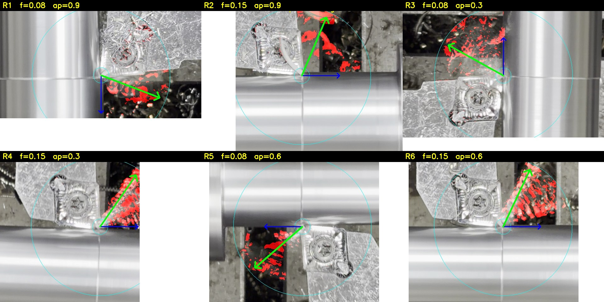

*Red: moving chip pixels found. Blue: feed direction. Green: measured chip direction.*

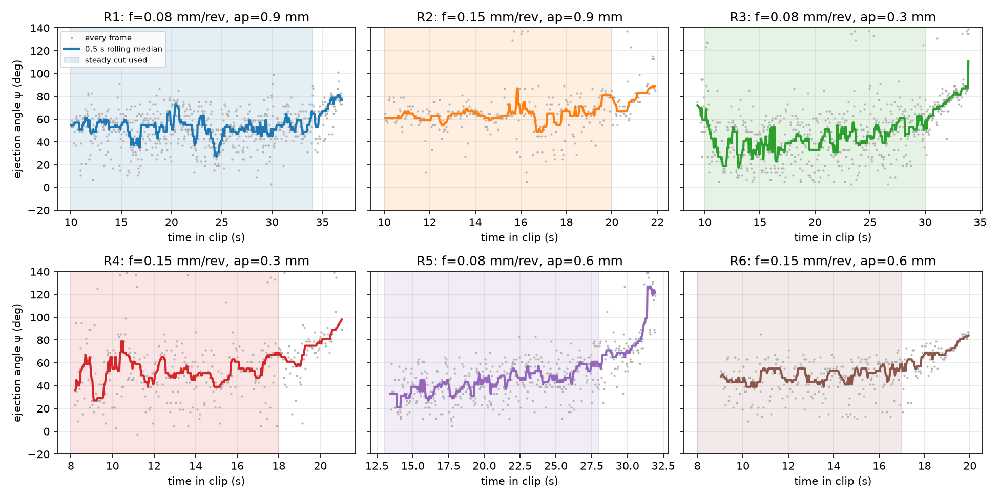

| Run | f | ap | ψ mean (°) | 95% CI (°) | Frame-to-frame SD (°) |
|---|---|---|---|---|---|
| R1 | 0.08 | 0.9 | 51.5 | 49.4 – 53.4 | 14.7 |
| R2 | 0.15 | 0.9 | 61.7 | 59.0 – 64.9 | 16.5 |
| R3 | 0.08 | 0.3 | 41.8 | 38.8 – 45.3 | 19.3 |
| R4 | 0.15 | 0.3 | 50.2 | 46.9 – 53.8 | 20.2 |
| R5 | 0.08 | 0.6 | 43.3 | 39.5 – 46.9 | 14.9 |
| R6 | 0.15 | 0.6 | 45.9 | 44.0 – 47.6 | 15.1 |

### 2.1 Sensitivity analysis: is the result an artefact of our settings?

We re-ran the whole measurement with different settings. We changed the analysis ring radius (150 / 220 / 300 px) and the motion threshold (12 / 18 / 28). We also tried a weighted-mean direction estimator instead of the histogram peak.

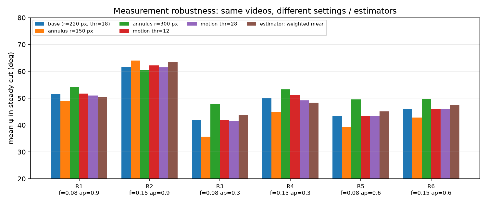

| Effect of raising feed 0.08 → 0.15 (°) | Base | Ring 150 | Ring 300 | Thr 12 | Thr 28 | Weighted mean |
|---|---|---|---|---|---|---|
| R1 → R2 (ap 0.9) | +10.1 | +14.9 | +6.2 | +10.5 | +10.5 | +13.0 |
| R3 → R4 (ap 0.3) | +8.4 | +9.3 | +5.5 | +9.2 | +7.8 | +4.8 |
| R5 → R6 (ap 0.6) | +2.7 | +3.6 | +0.3 | +2.7 | +2.7 | +2.3 |

**Robust:**
- **The motion threshold barely matters** (±1°).
- **The two direction estimators agree** within 2–3°.
- **The feed effect is positive in all 18 cases.**

**Not robust:**
- **The ring radius shifts every run by 3–6°.**
  - A larger ring sees chips further out, after they have curved more.
  - So the absolute angle depends on *where* you measure it; the comparison between runs does not.
- **The streak-orientation estimator failed.** It is close to noise: SD 40–50° per frame, low coherence. At 30 fps the chips appear as blobs, not streaks. A 240-fps camera should fix this.

## 3. Theory, and the curl hybrid

`code/physics_flow_angle.py` computes the rake-face flow angle η from the engaged edge geometry in two ways:
- **Colwell's chord model**;
- **Young–Mathew–Oxley's area-weighted normals.**

Theory says η is large when ap is small compared with the nose radius, and that feed hardly matters. The measured ψ does the opposite (r = −0.52).

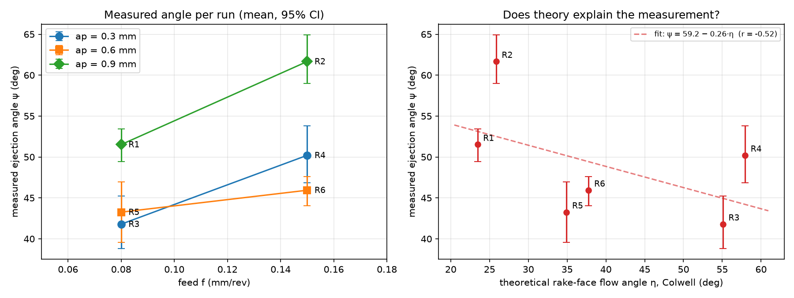

**Hypothesis:** the camera sees the chip *after* it curls up off the rake face, not the flow direction on the rake face.

**Test:** we fitted a geometric up-curl model. The chip leaves the rake face at η, then turns up by a curl angle φ that depends on chip thickness. Its top-view direction is then ψ = atan2(sin η, −cos η·cos φ).

**Result: it fails** (LOO RMSE 9.2°, worse than the baseline).

**Why it fails:** pure curl can only rotate the visible direction *away* from the rake-face flow direction toward "forward". That requires tan ψ ≥ tan η, which is false for R3 and R4 (small ap, where η ≈ 55–58° > ψ). So at small depth of cut the chip is pushed back *toward* the feed direction by something curl doesn't model. Two candidates:
- the chip breaker groove;
- the chip hitting the freshly cut shoulder.

**What would settle it:** a photo of the insert (to check for a chip breaker) and the chip shapes.

## 4. Parameter → angle: 11 models

Every model is scored by leave-one-run-out cross-validation: fit on 5 runs, predict the 6th, repeat for all 6 (`code/model_zoo.py`).

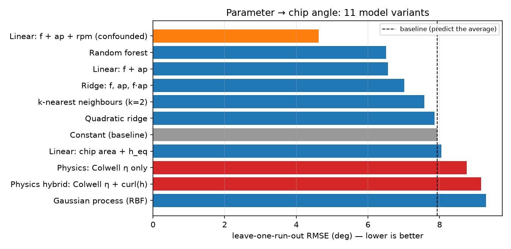

| Model | LOO RMSE (°) | LOO MAE (°) |
|---|---|---|
| Linear: f + ap + rpm *(confounded, see below)* | 4.6 | 3.9 |
| Random forest (f, ap) | 6.5 | 5.6 |
| **Linear: f + ap** | **6.6** | **5.8** |
| Ridge with f·ap interaction | 7.0 | 5.9 |
| k-nearest neighbours (k = 2) | 7.6 | 6.4 |
| Quadratic ridge | 7.9 | 6.7 |
| *Constant (predict the average)* | *7.9* | *6.5* |
| Linear: chip area + equivalent chip thickness | 8.1 | 6.7 |
| Physics: Colwell η | 8.8 | 7.8 |
| Physics hybrid: η + curl | 9.2 | 7.9 |
| Gaussian process (RBF) | 9.3 | 8.6 |

**Reading the table:**
- **The best-looking model is a trap.** Adding rpm drops the error to 4.6°, but rpm here is fixed by the bar diameter, which shrank run by run. "rpm" is really "run number". It could stand for tool wear, chip build-up on the guard, the camera getting closer, or a real diameter effect. **We can't tell which, so we don't trust it.** The next session should randomise the run order to break this link.
- **Linear f + ap stays the recommended model:** ψ ≈ 26.8 + 101·f + 17.7·ap.
- **Flexible models (GP, quadratic, kNN) are worse than a straight line.** With 6 points they overfit. The random forest ties with linear only because it effectively averages neighbours.

### 4.1 Within-run drift

A frame-level gradient-boosting model improves when it is told *how far into the cut* the frame is. Frame error drops from 9.1° to **7.2°** (LORO).

**The angle drifts upward during the cut.** Drift from start to end of the steady window, per run:

| Run | Drift (°) |
|---|---|
| R1 | −2 |
| R2 | +9 |
| R3 | +22 |
| R4 | +10 |
| R5 | +27 |
| R6 | +11 |

Possible causes: chips piling up and deflecting new chips, tool heating, or the camera's view changing as the tool moves. It is systematic, so a live monitor should compare the angle against a *time-dependent* expectation, not a constant.

## 5. CNN: reading the angle straight from the image (Kaggle GPU)

**v1 (iteration 1):** a ResNet-18 fine-tuned on 2,336 RGB crops around the tool tip. Its leave-one-run-out error was no better than predicting the average, and it got the feed wrong. The cause: with 6 clips it learned *which clip* a frame came from (lighting, background, camera position), not the chips.

**v2 (this iteration):** if the network memorises the background, take the background away. Four variants were trained on the same crops with the same LORO test (`kaggle/kernel_v2/train_v2.py`, Kaggle T4, 14 min):
- **RGB fine-tune:** v1 again with stronger jitter and shifts, as the control.
- **Masked RGB:** pixels that do not move between frames are blacked out.
- **Motion input:** the three channels are [grey frame, |difference to previous frame|, |difference to next frame|]. The crops are already aligned on the tool tip, so only the chips light up.
- **Linear probe:** frozen ImageNet features of the motion input plus ridge regression. It has too few parameters to memorise clips.

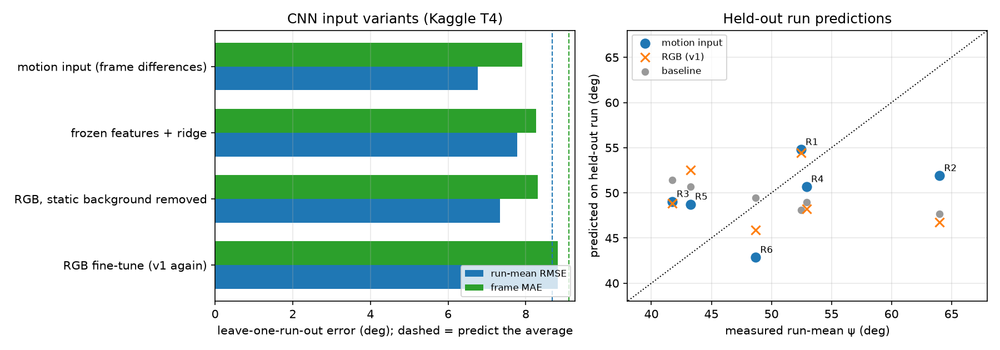

| Variant | Run-mean RMSE (°) | Frame MAE (°) | r (pred vs true, 6 runs) | Feed class (frames) |
|---|---|---|---|---|
| Predict the average | 8.7 | 9.1 | n/a | n/a |
| RGB fine-tune (v1 again) | 8.8 | 8.8 | −0.30 | 9% |
| Linear probe on motion | 7.8 | 8.3 | 0.20 | 26% |
| Masked RGB | 7.3 | 8.3 | 0.24 | 17% |
| **Motion input** | **6.8** | **7.9** | **0.42** | 24% |

**Result:**
- **Every "remove the background" variant beats plain RGB.** The motion input is best: run-level error drops from 8.8° to **6.8°**, close to the best parameter model (6.6°). This supports the v1 diagnosis: the network was using the background.
- **The predictions are still squeezed toward the average.** For example, R2 measured 64° but the CNN said 52°. With 5 training clips there is little to learn the range from.
- **Feed from the image still fails for every variant.** The audio sensor (section 6) does that job far better.
- **Recommendation:** keep the motion-input CNN as the image model for the next dataset, and keep the hand-crafted measurement as the live monitor until then.

## 6. Application 1: the microphone as a virtual sensor

The phone's sound track carries the machine's state (`code/audio_sensor.py`):
- **Spindle speed:** the rotating spindle produces a fundamental tone plus harmonics. A harmonic-sum pitch search (8 harmonics, 2-s windows) turns it into a tachometer.
- **Cutting on/off:** chip/tool contact noise is concentrated at 2–6 kHz. Its energy steps up when the cut starts and drops when it stops.
- **Feed (inverse problem):** the program cuts a known 61 mm, so f = 61 / (cut duration × rev/s).

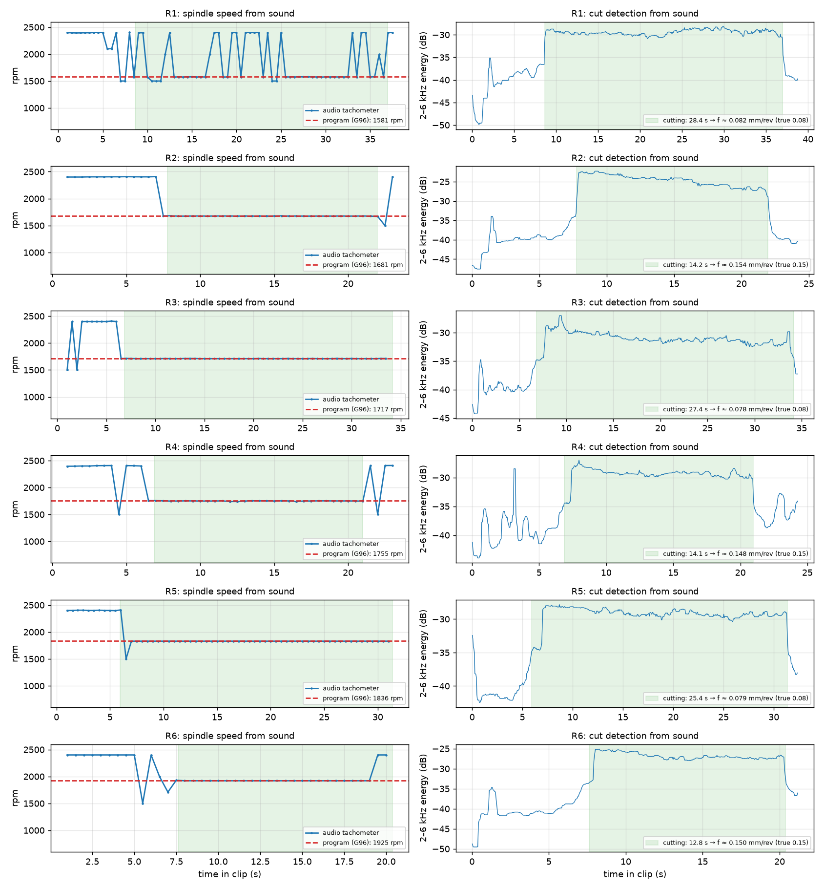

| Run | rpm (program) | rpm (sound) | Cut time (s) | Feed true | Feed from sound | Error |
|---|---|---|---|---|---|---|
| R1 | 1581 | 1576 | 28.4 | 0.08 | 0.0819 | +2.4% |
| R2 | 1681 | 1675 | 14.2 | 0.15 | 0.1539 | +2.6% |
| R3 | 1717 | 1710 | 27.4 | 0.08 | 0.0783 | −2.2% |
| R4 | 1755 | 1750 | 14.1 | 0.15 | 0.1483 | −1.1% |
| R5 | 1836 | 1830 | 25.5 | 0.08 | 0.0786 | −1.8% |
| R6 | 1925 | 1920 | 12.8 | 0.15 | 0.1495 | −0.3% |

- **The sound confirms G96 constant cutting speed.** Measured rpm rises run by run exactly as 150 000/(πD) predicts, to within 0.3–0.4%. This also checks the diameters we inferred from the photos.
- **The sound is also a load sensor.** Cutting-noise level correlates with log(material removal rate) at r = 0.91. This agrees with the controller's spindle-load readings in the photos: R2 at 23% (MRR 338 mm³/s) vs R4 at 18% (113 mm³/s).

## 7. Application 2: entanglement / chip build-up alarm

The project's original goal is monitoring chip entanglement. In R2 the chips really did snarl around the tool (visible in the side view at ~20 s).

**The indicator** (`code/entangle_indicator.py`) needs no training. It compares each run with its own first 4 s of cutting, using three signals:
- **moving area**: more chip mass in motion;
- **spray width**: chips leaving in all directions;
- **static clutter**: chips piling up in front of the tool.

Each is turned into a robust z-score, and the alarm fires when the average stays above 3 for 1 s.

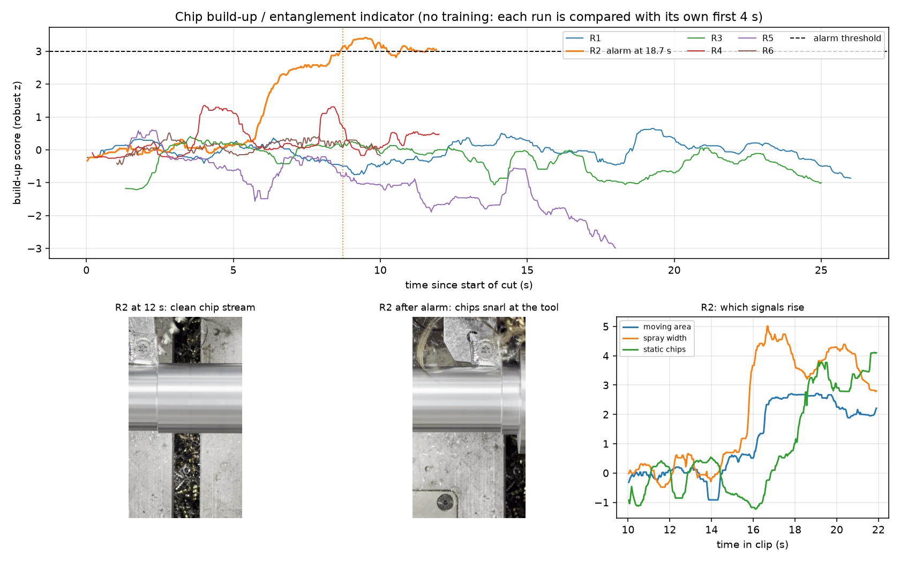

**Result:**
- **It fires only on R2**, at 18.7 s (20.1 s in the causal live version), which is when the tangle forms.
- **The other five runs peak at 0.4–1.35.** Any threshold between 1.4 and 3.4 separates them.
- **Signal order in R2:** spray width rises first, then moving area, then static clutter as the snarl grows.
- **Caveat:** this is one positive event. The threshold needs more tangles (and non-tangles) to set properly.

## 8. Application 3: live-monitor dashboard

`code/live_monitor_demo.py` replays a run exactly as a live system would see it. All signals are computed causally (from past frames only). The dashboard shows:
- the tracked tool tip and the chip direction drawn on the video;
- an angle dial, with the model's prediction for the current settings for comparison;
- rpm and the cutting state from the microphone;
- the build-up score, with the alarm.

The measurement runs at about 25 frames/s on a laptop, so a real-time version only needs a fixed camera. Videos: `results/demo/R2_live_monitor.mp4` (alarm case) and `results/demo/R5_live_monitor.mp4` (normal).

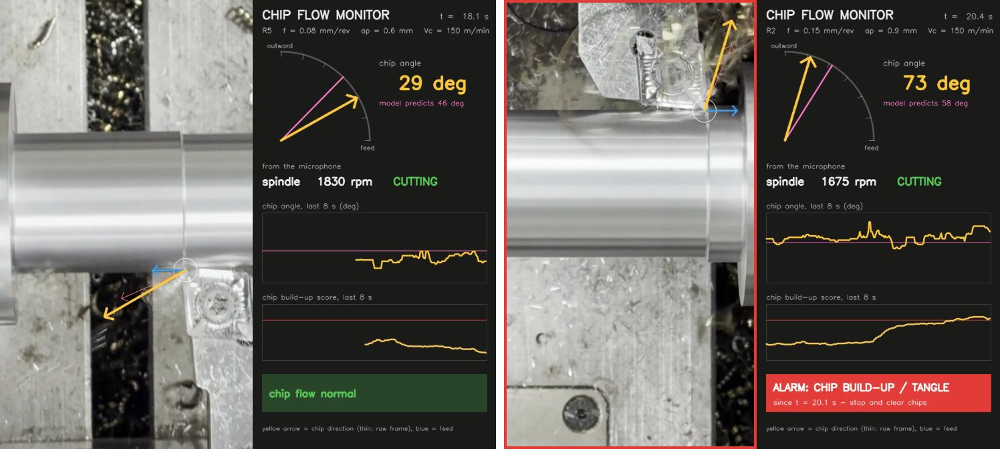

*Left: R5, normal chip flow. Right: R2 after the alarm; the chips have snarled at the tool.*

## 9. Application 4: process map

**What the map is for:** picking cutting settings to throw chips in a chosen direction, for example away from the operator or the camera, or into the chip tray.

The left map shows the fitted model; the right map shows what flow theory alone would suggest. The two disagree in direction, which is the main open question of the project.

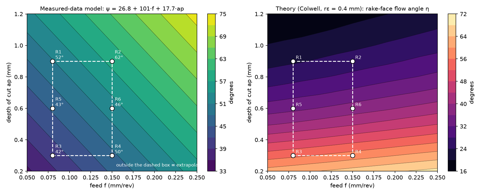

## 10. Inverse models: can the sensors tell us the settings?

| Target | From | Leave-one-run-out result |
|---|---|---|
| Feed (0.08 vs 0.15) | Audio: cut time + tachometer | **6/6**, mean error 1.7% |
| Feed class | Audio: cutting-noise level alone | 3/6 (chance) |
| Feed class | Video: ψ, spread, reach | 1/6 |
| Feed class | Video: activity, clutter | 0/6 |
| Depth of cut | Audio level + known feed | MAE 0.19 mm (baseline 0.24 mm) |

**Reading the table:**
- **The physics-based audio estimate works perfectly.** Pure classifiers on 5 training points do worse than chance: in leave-one-out, each held-out run makes its own class the minority in the training set.
- **Depth from sound:** cutting noise should scale with removal rate (f·ap·Vc), so with the feed known, the level should give the depth. It only beats the baseline slightly. The phone's distance to the tool changed between runs and its gain is uncalibrated.

## 11. Caveats

- **Data:**
  - **6 runs, one tool, one material, one cutting speed.** Feed has 2 levels and depth 3.
  - **Run order = diameter = rpm.** Any time trend in the session is mixed up with these.
  - **No camera calibration, handheld phone.** The absolute angle shifts by 3–6° with the analysis ring radius.
- **Assumptions:** **tool geometry, material and chip breaker are assumed.** The flow theory depends strongly on the nose radius.
- **Entanglement alarm:** **validated on a single real tangle.**

## 12. Next steps

1. **Measure the chips** (thickness and curl radius) and **photograph the insert code / chip breaker.** This decides why the curl model fails at small ap.
2. **Next lab visit:**
   - **Camera:** tripod/magnetic mount, 120–240 fps (makes the streak estimator usable), and a calibration photo.
   - **Run plan:** **randomised run order.** Repeat the centre point. Vary cutting speed. Try a deliberately long-chip setting to get more tangles.
3. **Retrain the CNN once there are ~30 runs.** The motion-input version is the one to keep (section 5).

## 13. Live web application and calibration

**What it is.** A laptop runs the analysis and shows a dashboard; a phone propped at the machine is only the camera and microphone (it opens a web page, there is nothing to install). The code is in `app/`; how to run it, and a rehearsal checklist, is in `app/README.md`.

```
phone (camera + mic) --https/websocket--> laptop server --> dashboard (laptop browser)
                                   same engine <-- replay of recorded runs R1-R6
```

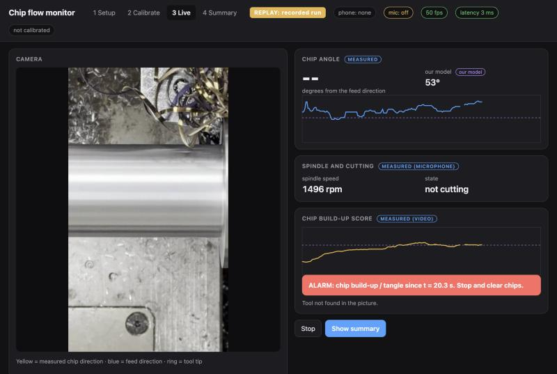

*The dashboard in replay mode (R2 after the alarm). Every number is tagged measured / our model / literature.*

**The four steps on the dashboard**
1. **Setup**: diameter, feed, depth of cut, Vc, nose radius, material. It shows the model's expected chip angle, the expected spindle speed, whether the setting is outside the six tested runs, and where it sits on a feed-vs-depth chart.
2. **Calibration**: the phone page shows a level indicator; the user clicks the tool tip, a point toward the chuck and a point on the workpiece (these give the tip, the feed direction and which side is "outward"); optionally two ends of a known length for a scale; then records 3 s of idle sound, which must match the expected spindle speed (computed on the diameter *before* the cut, because G96 sets the speed from the current diameter).
3. **Live**: video with tip, feed and chip arrows; the angle as a number and a trace, drawn against the model value; build-up trace; spindle speed and CUTTING/idle from the sound; alarm banner. The cut start and end come from the microphone; if the microphone is off, the cut is taken to start at the first valid frame.
4. **Summary**: measured against predicted angle, alarm time, CSV export.

**Replay mode** runs the recorded video and sound through exactly the same code, labelled REPLAY on screen. It is the fallback if the phone, the Wi-Fi or the lathe is not available.

**How it was checked** (44 automated tests; the slow ones replay all six runs):

| Run | Offline median ψ (°) | Live engine median ψ (°) | Valid frames offline | Valid frames live | Alarm |
|---|---|---|---|---|---|
| R1 | 55 | 55 | 808 | 808 | — |
| R2 | 65 | 65 | 343 | 356 | 20.1 s |
| R3 | 49 | 49 | 729 | 731 | — |
| R4 | 57 | 57 | 380 | 389 | — |
| R5 | 49 | 49 | 554 | 549 | — |
| R6 | 53 | 53 | 328 | 328 | — |

- The live engine uses only past frames (one frame of delay, about 33 ms). Its median angle per run is **identical to the offline measurement on all six runs**, and the build-up alarm fires **only on R2**, at 20.1 s as in the validated demo video.
- **Speed:** the server needs a median of 26 ms from the arrival of a frame to the finished state (95th percentile 39 ms, 29 frames/s sustained), measured by streaming a run through the running server (`app/bench_latency.py`). The phone-to-dashboard time on a real network adds half the round-trip time, which the dashboard shows live; it was **not measured with a real phone** (see below).
- **Calibration matters.** The angle is measured from the tool tip, so a mis-clicked tip moves it. We moved the tip by 5 and 10 px (in the 960-px-wide picture) along and across the feed direction and re-measured the first 200 frames after calibration:

| Run | along feed: −10 | −5 | +5 | +10 | across feed: −10 | −5 | +5 | +10 |
|---|---|---|---|---|---|---|---|---|
| R2 | -2° | -2° | +2° | +2° | +2° | +0° | +0° | -1° |
| R3 | -7° | -5° | +2° | +5° | +1° | -3° | -1° | -1° |
| R6 | -2° | -2° | +1° | +3° | +2° | +2° | -2° | -2° |

  A 5 px error moved the median angle by up to 5°, a 10 px error by up to 7°. That is the same size as the model's leave-one-run-out error (6.6°), so the tip should be clicked carefully, on a still picture, and a calibration photo with a ruler is on the next-visit list.
- **A second, independent microphone cue for build-up did not work** (`code/audio_buildup_check.py`). Acoustic emission is known to respond to chip congestion (Dornfeld and Pan, 1985), so we tested whether the 2-6 kHz band level, or its short-term variation, rises on R2 when the chips tangle. It does not: on R2 the largest rise above the run's own first 4 s is -0.2 robust units for the level and 0.9 for the variation, against up to 1.9 and 1.2 on the five clean runs. A phone microphone hears ordinary sound; acoustic-emission sensors work at ultrasonic frequencies, so this is not a test of the published effect. The microphone therefore only gives spindle speed and cut on/off; the alarm stays video-only.

**What was not validated**
- All validation is on the **six handheld videos**. No cut has been made with the phone fixed on a stand.
- The **phone page has not been run on a physical phone yet**. It was tested in a desktop browser, and the same message protocol was exercised with a stand-in streamer (`app/fake_phone.py`). The rehearsal checklist in `app/README.md` covers this.
- The cut-start detection from sound was checked on the same recordings used to tune the noise margin (5.5 dB above the idle level).

## 14. Related work and how it was used

We looked for published work on three questions: where the chip leaves the tool, what is known about chip control and chip forms, and whether sound can tell us about chips. Only sources whose existence and main finding we could confirm are listed; for some we only had the abstract or the bibliographic record, which is stated.

| Source | What it says (as far as we checked) | What we took from it |
|---|---|---|
| Colwell (1954) [1] | Predicts the chip-flow angle of a single-point tool; the chip flows roughly perpendicular to the chord joining the ends of the engaged cutting edge | The chord model in `code/physics_flow_angle.py`; shown on the dashboard as the rake-face flow direction |
| Stabler (1951) [2] | Chip flow deviates from the normal to the edge by about the edge inclination angle (Stabler's rule); later work finds somewhat smaller values because of friction | Background only: our insert has no inclination angle, and the nose radius dominates |
| Young, Mathew, Oxley (1987) [3] | Includes nose-radius effects: each element of the cutting edge pushes the chip along its own normal | The area-weighted-normals version in `physics_flow_angle.py` |
| Jawahir and van Luttervelt (1993) [4] | The CIRP keynote summarising chip-control research | Motivation: why chip direction and chip form matter for entangling. Cited from its record; we did not review the full text |
| Dornfeld and Pan (1985) [5] | Acoustic emission count rate follows feed-induced segmented chips and responds to chip congestion/entangling | The idea of a second, sound-based build-up cue; tested in section 13, **negative with a phone microphone** |
| Sukvittayawong and Inasaki (1991) [6] | Chip form identified from acoustic emission with statistics, fuzzy sets and a neural network; over 90% correct in their experiments | A reference point for what a trained, high-frequency sensor can do; we have no chip-form labels to train such a classifier |
| Kishawy et al. (2018) [7] | Review of acoustic emission in machining, including chip formation | Background for the limits of audible sound versus acoustic emission |
| ISO 10910:1995, ISO 3685 [8] | A chip-control chart with feed and depth of cut as axes; chip-form codes with long/short/snarled sub-classes | The axes of the feed-depth chart in the app and the vocabulary "long" / "snarled" for labelling our six runs |

**What this changed in our work**
- **The theory result is now framed correctly.** The literature gives the flow direction *on the rake face*; our camera sees the chip after it has curled off the face. Across our six runs the theory runs the opposite way (r = −0.52, section 3), so the dashboard shows it as "literature: rake-face direction", not as a prediction of what the camera should read.
- **A published cue failed on our hardware.** Acoustic emission responds to chip congestion; the audible band of a phone microphone does not show it on our one tangled run. A proper test needs an acoustic-emission or contact microphone sensor.
- **A shared vocabulary.** We labelled the chips in our videos with the ISO 3685 sub-classes (long; snarled for R2 after about 19 s). The main chip-form codes (ribbon, tubular, helical) cannot be told reliably from 30 fps top-view video, so they are not assigned; the table is `code/observed_chip_forms.csv` and should be corrected from the collected chips.
- **What is still missing from the literature side:** chip-breaking limits for our insert and material (the chart in the app draws no class boundaries because we have no data for them).


---

**Code:** `code/` · **Per-frame data:** `results/frames_all.csv` · **Models:** `results/model_zoo.csv`, `results/sensitivity.csv`, `results/run_features.csv` · **Audio:** `results/audio_sensor.csv` · **Alarm:** `results/entangle_alarms.csv` · **Demo videos:** `results/demo/` · **Kaggle (private):** tyro09/me361-chip-angle-cnn, tyro09/me361-chip-angle-cnn-v2 · **Live app:** `app/` · **Validation:** `results/live_engine_regression.csv`, `results/tip_sensitivity.csv`, `results/audio_buildup_check.csv` · **Previous report:** `results/REPORT_v1.pdf`

## References

1. Colwell, L. V. (1954). Predicting the angle of chip flow for single-point cutting tools. *Transactions of the ASME* 76, 199-203.
2. Stabler, G. V. (1951). The fundamental geometry of cutting tools. *Proceedings of the Institution of Mechanical Engineers* 165.
3. Young, H. T., Mathew, P., Oxley, P. L. B. (1987). Allowing for nose radius effects in predicting the chip flow direction and cutting forces in bar turning. *Proceedings of the Institution of Mechanical Engineers* 201. DOI: [10.1243/PIME_PROC_1987_201_108_02](https://doi.org/10.1243/PIME_PROC_1987_201_108_02) (page numbers differ between catalogues, so none are given).
4. Jawahir, I. S., van Luttervelt, C. A. (1993). Recent developments in chip control research and applications. *Annals of the CIRP* 42(2), 659-693.
5. Dornfeld, D. A., Pan, C. S. (1985). A study of continuous/discontinuous chip formation using acoustic emission. *Journal of Applied Metalworking* 4, 18-29. DOI: [10.1007/BF02833673](https://doi.org/10.1007/BF02833673)
6. Sukvittayawong, S., Inasaki, I. (1991). Identification of chip form in turning process. *JSME International Journal, Series III* 34(4), 553-560. [J-STAGE](https://www.jstage.jst.go.jp/article/jsmec1988/34/4/34_4_553/_article/-char/en)
7. Kishawy, H. A., et al. (2018). Application of acoustic emissions in machining processes: analysis and critical review. *International Journal of Advanced Manufacturing Technology*. DOI: [10.1007/s00170-018-2341-y](https://doi.org/10.1007/s00170-018-2341-y)
8. ISO 10910:1995, *Chip control: classification chart*; ISO 3685, annex on chip-form codes (the standards were not available to us in full; their use here follows the descriptions in the sources above).

The papers themselves are not bundled in this repository: most are behind publisher paywalls. The DOI links open them from a university network.
