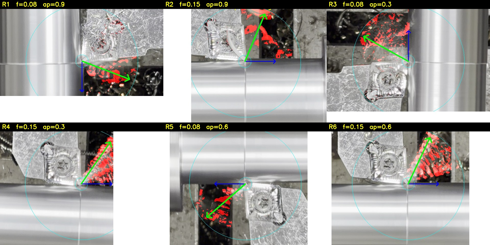
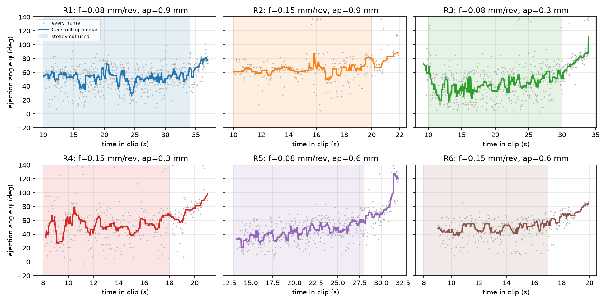
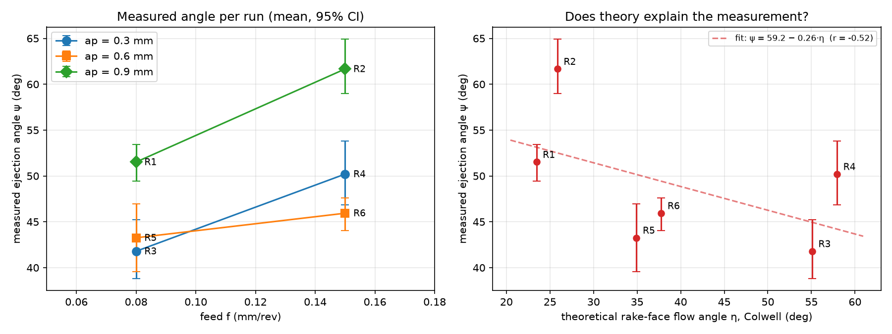
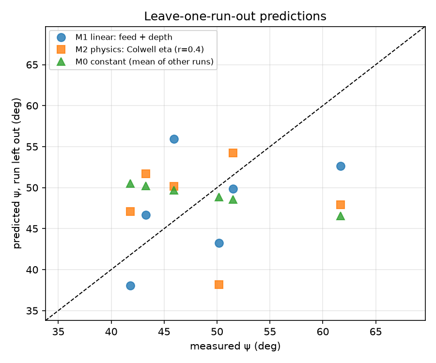
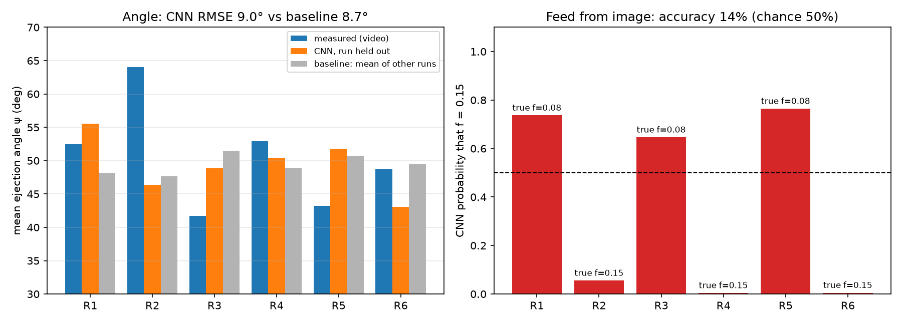

# Live monitoring of chip flow in turning: first model iteration

ME361 · session of 4 Nov 2026 · 6 runs · top-view phone video

> **In one line:** we can measure the chip ejection angle from ordinary phone video, frame by frame. It changes with **feed** (higher feed throws chips more outward in all 3 pairs) and with **depth of cut**. Textbook chip-flow theory alone does **not** predict it. With only 6 runs every model here is preliminary.

## 1. Data used

| Run | Feed f (mm/rev) | Depth ap (mm) | Diameter (mm) | rpm (G96, Vc = 150 m/min) | Frames used |
|---|---|---|---|---|---|
| R1 | 0.08 | 0.9 | 32.0 → 30.2 | 1581 | 690 |
| R2 | 0.15 | 0.9 | 30.2 → 28.4 | 1681 | 241 |
| R3 | 0.08 | 0.3 | 28.4 → 27.8 | 1717 | 499 |
| R4 | 0.15 | 0.3 | 27.8 → 27.2 | 1755 | 253 |
| R5 | 0.08 | 0.6 | 27.2 → 26.0 | 1836 | 418 |
| R6 | 0.15 | 0.6 | 26.0 → 24.8 | 1925 | 235 |

**Assumptions (not measured, to be replaced):**
- **Material:** mild steel, taken as AISI 1020.
- **Insert:** CCMT 09T304 (80° rhombic, screw-clamped, nose radius rε = 0.4 mm), held at a 95° entering angle (SCLCR). This matches what's visible in the videos; rε = 0.8 mm is also checked.
- **Coolant:** dry.

The side-view video was not used: it is too far away to see the chips.

## 2. Measuring the chip angle from video

The phone was handheld and followed the tool, so every clip has a different orientation. The script `code/measure_chip_angle.py` does this for every frame (~3,100 frames):

1. **Track the insert** with template matching, which gives the tool-tip position.
2. **Re-estimate the workpiece axis** from the long straight edges of the bar. This removes phone rotation.
3. **Find the moving chip pixels** using three-frame differencing, after cancelling the camera motion. Chips at 30 fps show up as motion streaks.
4. **Take the dominant direction** from the tip to the moving pixels. That direction is the **ejection angle ψ**:
   - ψ = 0° means the chip leaves along the feed direction (toward the chuck).
   - ψ = 90° means it leaves radially outward, straight away from the bar.

   Because ψ is measured relative to the workpiece, it doesn't depend on how the phone was held.

*Red: moving chip pixels found. Blue: feed direction. Green: measured chip direction.*

Only the **steady part of each cut** is used. At entry and exit the chip stops and the angle becomes meaningless, which is the jump at the end of every trace below.

**Measured ejection angle per run** (steady cut; 95% CI from a 1-s block bootstrap):

| Run | f | ap | ψ mean (°) | 95% CI (°) | frame-to-frame SD (°) |
|---|---|---|---|---|---|
| R1 | 0.08 | 0.9 | 51.5 | 49.4 – 53.4 | 14.7 |
| R2 | 0.15 | 0.9 | 61.7 | 59.0 – 64.9 | 16.5 |
| R3 | 0.08 | 0.3 | 41.8 | 38.8 – 45.3 | 19.3 |
| R4 | 0.15 | 0.3 | 50.2 | 46.9 – 53.8 | 20.2 |
| R5 | 0.08 | 0.6 | 43.3 | 39.5 – 46.9 | 14.9 |
| R6 | 0.15 | 0.6 | 45.9 | 44.0 – 47.6 | 15.1 |

## 3. What the theory says

`code/physics_flow_angle.py` builds the uncut chip area for one revolution (check: the area equals f × ap for every run). It then computes the **rake-face chip flow angle η** two ways:
- **Colwell (1954):** the chip flows perpendicular to the chord joining the two ends of the engaged cutting edge.
- **Young, Mathew & Oxley (1987):** each element of the edge pushes the chip along its own normal, weighted by the chip area it removes; the chip follows the sum.

η is measured from "straight back over the insert" toward "radially outward". It grows strongly when **ap is small compared with the nose radius**: Colwell gives 55° at ap = 0.3 mm but 23° at ap = 0.9 mm (rε = 0.4). Feed has only a small effect on η.

**Observed:**
- **Feed raises ψ in every pair:** +10° (R1→R2), +8° (R3→R4), +3° (R5→R6).
- **The deepest cut (0.9 mm) gives the largest ψ.**
- **The measured ψ goes against η** (r = −0.52).

**Why:** the camera sees the chip's **ejection direction after it curls**, not the flow direction on the rake face. The chip first slides back over the insert, as theory says, then curls up and over. That curl reverses the backward component, so the visible direction is forward and outward. The outward part comes from η; the forward part depends on how tightly the chip curls. Curl depends on chip thickness (feed) and the chip breaker, and Colwell/YMO don't model either. That is why η alone can't predict ψ.

## 4. Parameter → angle models

Each model is fitted on 5 runs and tested on the 6th, repeated for all 6 runs (leave-one-run-out cross-validation).

| Model | LOO RMSE (°) | LOO MAE (°) | R² (all 6 runs) |
|---|---|---|---|
| M0: constant (mean of other runs) | 7.9 | 6.5 | 0 |
| **M1: linear in feed + depth** | **6.6** | **5.8** | 0.71 |
| M7: hybrid, Colwell η + feed | 7.5 | 6.8 | 0.62 |
| M5: depth only | 7.9 | 7.1 | 0.43 |
| M6: feed only | 8.4 | 7.5 | 0.29 |
| M4: Colwell η (rε = 0.8) | 8.3 | 7.4 | 0.37 |
| M2: Colwell η (rε = 0.4) | 8.8 | 7.8 | 0.27 |
| M3: Young-Mathew-Oxley η | 9.1 | 7.9 | 0.22 |

**Best model (M1):** ψ ≈ 26.8 + 101·f + 17.7·ap (degrees; f in mm/rev, ap in mm).
- It beats the constant baseline by only ~1.4° on held-out runs.
- With 6 points and 3 coefficients, this is a trend, not a validated model.
- The physics-only models are worse than the baseline because they predict the wrong quantity (see section 3).

## 5. CNN: reading the angle straight from the camera (Kaggle GPU)

**Goal:** a model that looks at one camera frame and outputs the chip angle. That is what a live monitor would run.

**Setup:**
- 2,336 steady-cut crops around the tool tip, each rotated so the feed points right and outward points up (`code/make_crops.py`).
- Uploaded as a private Kaggle dataset (`tyro09/me361-chip-angle-frames`).
- ImageNet-pretrained ResNet-18 with two outputs: the angle ψ and the feed class.
- No flips or rotations as augmentation, because they would change the angle the label describes.
- Trained on a Kaggle Tesla T4 GPU, about 10 minutes, with the same leave-one-run-out testing as section 4 (`kaggle/kernel/train.py`).

| Held-out run | Measured ψ (°) | CNN (°) | Baseline (°) |
|---|---|---|---|
| R1 | 52.5 | 55.6 | 48.1 |
| R2 | 64.0 | 46.4 | 47.7 |
| R3 | 41.7 | 48.8 | 51.5 |
| R4 | 52.9 | 50.3 | 48.9 |
| R5 | 43.2 | 51.8 | 50.7 |
| R6 | 48.7 | 43.1 | 49.5 |
| **RMSE** | | **9.0** | **8.7** |

**Result: the CNN does not work yet.**
- **Angle:** about as good as guessing the average of the other runs (frame-level error 9.0° vs 9.1°).
- **Feed from image:** 14% accuracy, worse than a coin flip. For every held-out run the CNN predicted the feed the *other* runs mostly had.
- **Why:** with 6 runs it learns things that identify each clip (camera position, lighting, background) rather than the chips themselves. A new clip looks unfamiliar, so it falls back on the majority class.
- **What it needs:** many more runs and a fixed camera, so that the only thing changing between clips is the cut.

**What already works for live monitoring:** the measurement script from section 2. It runs at about 25 frames/s on a laptop, close to the video's 30 fps, and needs no training. For now it is the "live monitor"; the CNN becomes worthwhile once there are a few dozen runs.

## 6. Caveats

- **Only 6 runs, all one tool and one material.** Feed and depth each have 2–3 levels, and speed was not varied (Vc = 150 m/min throughout).
- **Run order is confounded with diameter and rpm.** The bar got thinner run by run, and runs were done in a fixed order rather than shuffled.
- **The angle comes from 2D projection of a handheld view.** Perspective and camera tilt add a few degrees of error. There was no calibration photo.
- **R3 and R5 drift upward by ~20° during the cut,** so the "steady" angle is partly a time average. The cause (heat, chip build-up, or the diameter shrinking) is unknown.
- **Tool geometry and material are assumed.** Changing the nose radius from 0.4 to 0.8 mm shifts η by 10–20°.
- **Chip thickness wasn't measured.** It would give the chip compression ratio, which links directly to curl.

## 7. Next steps

1. **Measure the collected chips** (thickness, curl radius) and photograph the insert code.
2. **Next lab visit:**
   - Mount the phone on a tripod or magnetic base.
   - Film at 120–240 fps.
   - Take a calibration photo.
   - Shuffle the run order.
   - Vary speed as well, and add a second nose radius.
   - Repeat the centre point.
3. **Add chip curl to the physics model** (e.g. curl radius vs. chip thickness), so η plus curl predicts the visible ψ.
4. **Grow the CNN dataset with the next session** and test the camera-only model on a new day.

---

**Code:** `code/` · **Per-frame angles:** `results/frames_all.csv` · **Per-run summary:** `results/run_summary.csv` · **Kaggle notebook (private):** tyro09/me361-chip-angle-cnn
